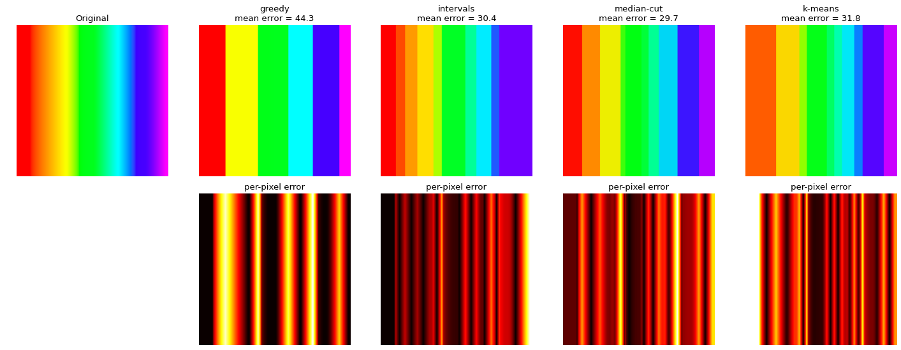
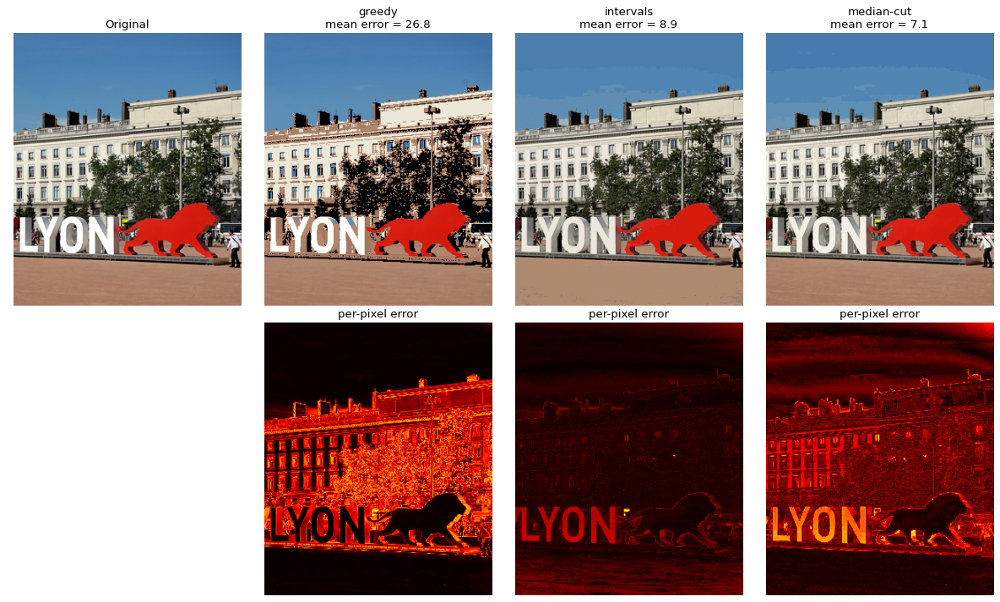

# Optimal Colour Palette

Finding a good k-colour palette for an image, four different ways, and measuring which one actually wins. Written for a graded autonomous assignment at École Centrale de Lyon (INF TC1, 2025).

The constraint that shaped the project: **no OpenCV, no NumPy for the image work, no `scikit-learn`**. Pillow is used to read and write pixels, and everything else — median cut, k-means, the Gaussian convolution — is written from scratch.

## The problem

Given an image with tens of thousands of distinct colours, pick k colours (say 100) and repaint every pixel with the closest one. A good palette keeps the image recognisable; a bad one flattens gradients and loses whole regions. "Closest" and "good" both need defining, which is most of the work.

## The four methods

| Method | How it picks the palette | Cost |
|---|---|---|
| `greedy` | the k most frequent colours | fast, ignores everything rare |
| `intervals` | sort colours by frequency, cut into k slices, sample each | fast, far better spread |
| `median-cut` | recursively split the 3D RGB cube at the median of its widest channel | slower, adapts to colour distribution |
| `k-means` | Lloyd's algorithm over the image's unique colours | slowest, converges to local optimum |

Each is wired to run in RGB, HSV or LAB, with an optional Gaussian blur pre-pass (3×3 or 7×7, convolution written by hand).

## Results

Error is the mean Euclidean RGB distance between each original pixel and the colour that replaced it — always measured back in RGB, so that HSV and LAB runs stay comparable. Heatmaps show where each method loses the most.

**Colour spectrum, k = 10** — a deliberately hard case, since every colour is equally rare:



Greedy collapses the spectrum onto six saturated bands; the other three keep the gradient readable.

**Photograph, k = 100:**



| Method | Mean error | Time |
|---|---|---|
| greedy | 26.85 | 2.6 s |
| intervals | 8.87 | 2.6 s |
| median-cut | 7.05 | 9.2 s |
| k-means | 6.00 | 169 s |
| Pillow `quantize` (reference) | 5.13 | 0.08 s |

(300×360 image, k=100, single run, k-means seeded for reproducibility.)

What this says:
- **`intervals` is the best value for money** — a one-line change from greedy, three times less error, same runtime.
- **k-means wins on error but costs ~65× median-cut's runtime**, because it re-scans every unique colour until the centroids stop moving. On the full-resolution image it becomes impractical.
- **Pillow still beats all four**, which is the honest result: it is a tuned C implementation. Being within ~1 error point of it with pure Python is the interesting part, not beating it.
- **Blurring first always made things worse.** It smooths the gradients the palette then has to approximate, adding error without reducing palette size. RGB matching consistently introduced less error than HSV or LAB.
- **k-means clusters unique colours, not pixels**, so a colour covering half the image weighs the same as one used once. That is a real difference from median-cut, and it shows on images with large flat regions.

## Run it

```bash
pip install -r requirements.txt

# recolour an image
python main.py images/lyon.png -k 100 --method median-cut

# try another space, with a blur pre-pass
python main.py images/lyon.png -k 100 --method k-means --space lab --blur gauss3

# compare every method on one image
python main.py images/lyon.png -k 100 --benchmark
```

`scikit-image` is only needed for `--space lab`; everything else runs on Pillow and NumPy alone.

## Layout

```
palette/
├── core.py           pixel access, colour counting, distance, convolution
├── methods.py        the four palette-selection algorithms
├── colour_spaces.py  RGB / HSV / LAB conversions
└── quantize.py       recolouring, error + heatmap, benchmarking
main.py               command-line interface
```

## Known limitations

- Pure Python pixel loops: runtime grows with image size, and k-means becomes impractical above a few hundred thousand pixels. Vectorising with NumPy would fix this, but was ruled out by the assignment.
- Palettes are built per image. Running one shared palette across several images of different sizes lets the largest image dominate — handled by allocating each image a share of k proportional to its pixel count, which is a workaround rather than a real multi-image method.
- k-means is seeded for reproducibility; without a seed, results vary between runs since the initial centroids are random.
